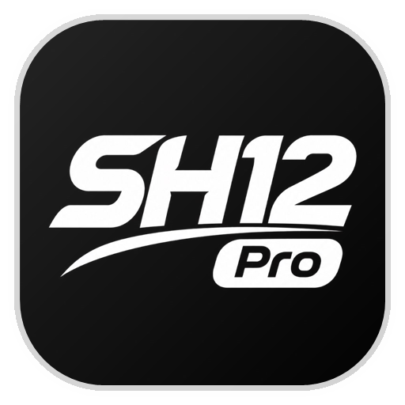

<div align="center">
  
  <h1>🖤 SH12 Pro — Subscription Server, Admin Dashboard & Telegram Bot</h1>
  <p><b>نظام إدارة الاشتراكات الاحترافي، لوحة التحكم السحابية، وبوت التفعيل الأوتوماتيكي لأداة SH12 Pro</b></p>
  <p>
    <a href="https://t.me/SH12Pro_Sub_bot"></a>
    <a href="https://t.me/vvshiko"></a>
  </p>
</div>

---

## ⚡ نبذة عن المشروع (Overview)
**SH12 Pro** هو نظام متكامل لإدارة وتأمين وتفعيل إضافة المتصفح الاحترافية **SH12 Pro** بنظام **الدفع لمرة واحدة فقط (مدى الحياة · Lifetime)**، مربوط ببصمة الهاردوير الفيزيائية لجهاز العميل (**HWID Lock**)، مع لوحة تحكم ويب متكاملة وبوت تيليجرام أوتوماتيكي يدعم تعدد وسائل الدفع.

---

## 🔥 أهم المميزات (Key Features)

### 🛡️ 1. حماية وتشفير الإضافة وبصمة الهاردوير (HWID & Code Shield)
- **بصمة هاردوير ثابتة (Persistent HWID):** قراءة بصمة كارت الشاشة (WebGL GPU)، المعالج، الشاشة، والصوت لتوليد معرّف ثابت (`ID-XXXX-XXXX-XXXX`) لا يتغير حتى في حال حذف الإضافة وإعادة تثبيتها.
- **تشفير كامل للكود (SH12 Pro Shield):** تشفير كافة ملفات الإضافة (`Hex XOR String Vault + Identifier Mangling + Anti-Tamper Checksum`) متوافق 100% مع معايير Chrome Manifest V3 لمنع سرقة الكود أو التعديل عليه.
- **الهوية الرسمية (Dark / White Monochrome UI):** تصميم فخم باللونين الأسود والأبيض مع دعم التبديل الفوري بين الوضع الداكن (**🌙 دارك**) والوضع الفاتح (**☀️ وايت**) ودعم اللغتين (**المصرية / الإنجليزية**).

### 🤖 2. بوت التيليجرام الأوتوماتيكي (`@SH12Pro_Sub_bot`)
- **ربط ذكي مع الأداة:** يضغط العميل على زر الاشتراك داخل الإضافة فيتم توجيهه للبوت مع إرسال سيريال الهاردوير تلقائياً (`/start ID-XXXX-XXXX-XXXX`).
- **دعم وسائل دفع متعددة (Multi-Payment Methods):** فودافون كاش، إنستا باي (InstaPay)، اتصالات كاش، باينانس، مع إمكانية إضافة أو تعديل أي وسيلة دفع من لوحة التحكم.
- **مراجعة الإيصالات وتوليد السيريال تلقائياً:** يرسل العميل صورة التحويل (Screenshot) للبوت، فتصل فوراً للأدمن مع أزرار (**✅ قبول وإرسال السيريال** / **❌ رفض الطلب**). بمجرد الضغط على قبول، يصنع البوت كود التفعيل (`SH12-XXXX-XXXX-XXXX-XXXX`) ويرسله للعميل أوتوماتيكياً.

### 👑 3. لوحة تحكم الإدارة الاحترافية (Web Admin Dashboard)
- **تحكم لحظي عن بُعد (Remote Control):**
  - **🚫 قطع الاشتراك:** إيقاف تفعيل الأداة لدى العميل فوراً مع إمكانية إعادة التفعيل بضغطة زر.
  - **🗑 حذف نهائي:** مسح اشتراك العميل وحظر جهازه نهائياً مع مسح الكود المحفوظ في متصفحه وإغلاق الأداة فوراً.
- **🎫 إصدار بطاقات عضوية VIP (PNG):** توليد وتحميل بطاقة تفعيل رسمية فخمة باسم العميل وسيريال جهازه وكود التفعيل بضغطة زر.
- **📢 نظام الإشعارات الجماعية (Broadcast) + 📥 النسخ الاحتياطي (JSON Backup).**

---

## 🚀 التشغيل السريع (Quick Start)

```bash
# تشغيل السيرفر ولوحة التحكم وبوت التيليجرام
npm start
```
ثم افتح المتصفح على الرابط: `http://localhost:3000`

---

## 👨‍💻 المطور والدعم الفني (Developer & Support)
- **البوت الرسمي للاشتراكات:** [@SH12Pro_Sub_bot](https://t.me/SH12Pro_Sub_bot)
- **المطور والدعم الفني المباشر:** [@vvshiko](https://t.me/vvshiko)
